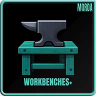
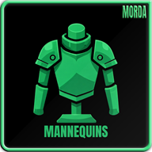
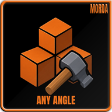

 

**Fly your camera anywhere and build from above.**

Press **F6** with the hammer in your hand, fly around freely and place or remove pieces far from your character. Numpad **+ / -** changes the speed. Client side only.

> **Client side only, no server install needed.** Valheim 1.0 · BepInExPack 5.4.2350+ · Console players cannot load the mod.

|  |  |  |  |  |
|:---:|:---:|:---:|:---:|:---:|
| **Cam** **F6** on / off, with the hammer in hand | **Fly** WASD and mouse, Space / Ctrl up and down | **Speed** Numpad **+ / -** | **Boost** Hold Shift to fly faster | **Build** Place and remove pieces far from your character |

Every key can be changed in the config file.

| Key | What it does |
|:---|:---|
| **F6** | Build cam on / off (hammer in hand) |
| **W A S D** | Fly forward, left, back, right (in the direction you look) |
| **Mouse** | Look around |
| **Space / Left Ctrl** | Fly up / down |
| **Left Shift** | Boost (3x speed) |
| **Numpad + / -** | Faster / slower |
| **Right mouse** | Piece menu, as usual |

### How it works
- **F6** only works while a build tool (hammer) is equipped. Put it away and the camera switches off
- Your character stands still while the camera flies
- While the camera is on, the build and remove range is no longer limited to your character. The camera ray itself reaches **50 m**
- Chat, menus, the inventory and the piece menu pause the camera controls
- A short message in the middle of the screen shows **Build Cam ON / OFF**

### Settings
The file is `BepInEx/config/com.morda.easybuildcam.cfg`.

| Setting | Default | What it does |
|:---|:---|:---|
| Toggle | F6 | Camera on / off |
| Faster / Slower | Numpad + / - | Change the speed |
| Up / Down | Space / Left Ctrl | Fly up / down |
| Boost | Left Shift | Hold to fly faster |
| Speed | 10 | Flying speed in meters per second |
| SpeedStep | 1.25 | Each key press multiplies or divides the speed by this |
| BoostMultiplier | 3 | Speed factor while boost is held |
| MouseSensitivity | 2 | Mouse look sensitivity |

|  |  |  |  |
|:---:|:---:|:---:|:---:|
| **[Store and Craft](https://thunderstore.io/c/valheim/p/Morda/StoreAndCraft/)** | **[Workbenches+](https://thunderstore.io/c/valheim/p/Morda/WorkbenchesPlus/)** | **[Forager's Garden](https://thunderstore.io/c/valheim/p/Morda/ForagersGarden/)** | **[Morda's Gearhold](https://thunderstore.io/c/valheim/p/Morda/MordasGearhold/)** |

|  |  |  |  |
|:---:|:---:|:---:|:---:|
| **[Valheim Mannequins](https://thunderstore.io/c/valheim/p/Morda/ValheimMannequins/)** | **[ServerRates](https://thunderstore.io/c/valheim/p/Morda/ServerRates/)** | **[Smooth Build Repair](https://thunderstore.io/c/valheim/p/Morda/SmoothBuildRepair/)** | **[Any Angle](https://thunderstore.io/c/valheim/p/Morda/AnyAngle/)** |

1. Install [BepInExPack Valheim](https://thunderstore.io/c/valheim/p/denikson/BepInExPack_Valheim/)
2. Put `EasyBuildCam.dll` in `BepInEx/plugins/EasyBuildCam/` (or use Thunderstore / r2modman)
3. Client side: no install on the server needed

